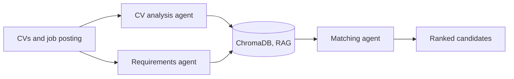

<div align="center">

<h1>Pelin Su Sabancı</h1>

<b>AI & Machine Learning Developer</b><br />
<sub>LLM uygulamaları, RAG ve çok ajanlı sistemler geliştiriyorum.</sub>


<a href="https://www.linkedin.com/in/pelinssabanci">
  
</a>
<a href="https://github.com/pelinssbnc">
  
</a>
<a href="mailto:pelinssabanci@gmail.com">
  
</a>

<br /><br />


</div>

## 👋 about

Hi! I'm a computer programmer who likes making AI useful in the real world: machine learning, data analysis, computer vision, LLM apps, and retrieval-augmented generation. My rule of thumb is simple: *if I can't measure it, I don't ship it.*

```python
class Pelin:
    role    = "AI & Machine Learning Developer"
    now     = "AI Developer Intern @ Barfasta"
    studies = "Management Information Systems @ Anadolu University"
    degree  = "Computer Programming @ Piri Reis University"
    builds  = ["RAG pipelines", "multi-agent systems", "predictive models", "CNN classifiers"]

    def ask_me_about(self) -> list[str]:
        return ["RAG", "agents", "LLM evaluation", "computer vision", "scikit-learn"]

    def ship(self) -> str:
        return "practical software that actually works"
```

### 📡 currently training

```text
$ python learn.py
> epoch 1: advanced RAG architectures ......... running
> epoch 2: multi-agent systems ................ running
> epoch 3: LLM evaluation & optimization ...... running
> epoch 4: deploying AI applications .......... queued
```

<details>
<summary><b>🌱 how I got here</b></summary>
<br />

| Year | What happened |
| --- | --- |
| **2022** | Started Computer Programming at Piri Reis University. |
| **2024** | Frontend Developer Intern at Koçtaş. React, JavaScript, reusable interfaces. |
| **2025** | Completed the associate degree in Computer Programming. |
| **2026** | AI Innovators Summer Intern at Microsoft. Started Management Information Systems at Anadolu University. AI Developer Intern at Barfasta. |

</details>

## 🚀 projects

### ⭐ AuraRecruit
<sub><b>multi-agent RAG · recruitment</b></sub>

An AI recruitment platform. Specialized agents and a RAG architecture analyze CVs, evaluate job requirements, and match candidates with suitable positions.



`Python` · `FastAPI` · `LangChain` · `LangGraph` · `Gemini API` · `ChromaDB` · `React` · `TypeScript`

<table>
<tr>
<td width="33%" valign="top">

#### 📈 Predictive analytics
<sub><b>machine learning</b></sub>

Data preprocessing, feature engineering, regression, classification, and model evaluation.

`Python` · `Scikit-learn` · `Pandas` · `NumPy`

</td>
<td width="33%" valign="top">

#### 🖼️ Image classification
<sub><b>computer vision</b></sub>

CNN architectures with transfer learning, built with TensorFlow and Keras.

`TensorFlow` · `Keras` · `CNN`

</td>
<td width="33%" valign="top">

#### 🌐 Web applications
<sub><b>frontend and full-stack</b></sub>

Interfaces and full-stack apps with React, JavaScript, TypeScript, and modern web tooling.

`React` · `JavaScript` · `TypeScript`

</td>
</tr>
</table>

## 💼 experience

| Role | What I do |
| --- | --- |
| **AI Developer Intern**<br><sub>Barfasta · Nov 2026 – Present</sub> | Test AI systems and evaluate their performance. Improve system behavior through testing and iteration. |
| **AI Innovators Summer Intern**<br><sub>Microsoft · Jun – Jul 2026</sub> | Worked with generative AI, LLMs, and RAG architectures. Built AI-powered applications and workflows. |
| **Frontend Developer Intern**<br><sub>Koçtaş · Jul – Aug 2024</sub> | Built responsive interfaces with React and JavaScript. Created reusable components. |

## 🎓 education

| School | Program |
| --- | --- |
| **Anadolu University**<br><sub>2026 – Present</sub> | Management Information Systems |
| **Piri Reis University**<br><sub>2022 – 2025</sub> | Associate Degree in Computer Programming |

## 🧰 stack

<p align="center">
  
</p>

<p align="center">
  <code>LLMs</code> <code>RAG</code> <code>LangChain</code> <code>LangGraph</code> <code>Gemini API</code> <code>ChromaDB</code> <code>Keras</code>
</p>

## 🤝 let's talk

Working on generative AI, RAG, or multi-agent systems? Let's compare notes.

<p align="center">
  <a href="mailto:pelinssabanci@gmail.com">
    
  </a>
  <a href="https://www.linkedin.com/in/pelinssabanci">
    
  </a>
</p>


